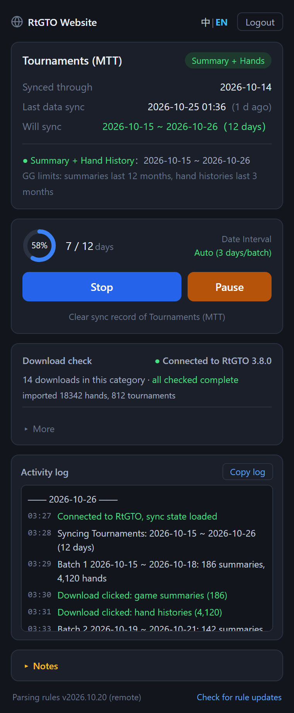

# GGPoker Record Download Helper

[简体中文](README.md) | **English**

A browser extension that helps GGPoker players download their game summaries and hand histories. Works in Chrome and Microsoft Edge.
Downloaded records can be imported straight into [RtGTO](https://www.rtgto.net) for analysis.

Website: [www.rtgto.net](https://www.rtgto.net)

## Screenshots

<p>
  
</p>

The main panel during a sync: sync status, progress, [RtGTO](https://www.rtgto.net) download check and activity log. Sample data shown.

## Features

- **One-click sync, no dates to pick**: the extension remembers how far each category has been synced. Click "Sync Now" and it fetches everything from then until today; the first sync starts from the earliest day GG still keeps.
- **8 categories**: Tournaments (MTT), Mystery Battle Royale and Spin & Gold get game summaries and hand histories; Rush & Cash, Hold'em Cash, Omaha (PLO), All-in or Fold and Short Deck get hand histories.
- **Gets as much as GG allows**: GG keeps summaries for 12 months and hand histories for 3 months, and the extension downloads within those limits. Batch size adjusts automatically to GG's per-download limits (500 summaries / 20,000 hands), and a single day over the limit is split up.
- **You click download**: for every batch the extension highlights GG's download button and waits for your click before moving on. You can pause, resume or stop at any time.
- **Tournaments still running**: their summaries and hands so far are downloaded too; sync again after they finish to re-download the complete data from that day.
- **Automatic checking with [RtGTO](https://www.rtgto.net)**: when [RtGTO](https://www.rtgto.net) is open on the same computer, downloaded files are handed to it to check and import. Dates missed because of a dropped network or similar show up under re-download, ready to fetch in one click.
- **Activity log**: every step is logged and stays after refreshing or reopening the side panel. If something goes wrong, "Copy log" and send it to support.
- **Chinese and English interface**; works in Chrome and Edge.
- **Your data stays local**: records are saved to the browser's download folder, and the extension doesn't upload your hands.

## Requirements

- Chrome or Microsoft Edge 116 or later
- Official GGPoker sites only:
  - https://my.pokercraft.com/*
  - https://*.ggpoker.com/*
  - https://gateway.realtimegto.com/*

## Installation

1. From the Chrome Web Store
   - Open the Chrome Web Store
   - Search for "GGPoker记录下载助手"
   - Click "Add to Chrome"

2. Manual install (developer build, Chrome)
   - Download this project as a ZIP and extract it
   - Open the extensions page in Chrome (chrome://extensions/)
   - Turn on "Developer mode" in the top-right corner
   - Click "Load unpacked"
   - Select the extracted folder

3. Manual install (developer build, Edge)
   - Download this project as a ZIP and extract it
   - Open the extensions page in Edge (edge://extensions/)
   - Turn on "Developer mode" on the left
   - Click "Load unpacked"
   - Select the extracted folder
   - On a GGPoker site, click the extension icon in the toolbar (you can pin it from the "Extensions" menu); the side panel opens on the right

## Usage

1. On a GGPoker site, click the extension icon to open the Side Panel
2. The first time, log in:
   - Enter your username and password
   - Optionally tick "Remember password"
   - Click "Login"
3. After login, set the download options:
   - Pick a start date and end date (up to 360 days)
   - Pick a date interval (1–3 days)
4. Click "Start" to begin downloading
5. While downloading you can:
   - Click "Pause" to pause
   - Click "Stop" to stop
   - Watch live progress and status
6. When finished:
   - Records are saved to the browser's download folder

## Download records and re-download ([RtGTO](https://www.rtgto.net) analysis module)

The extension can only confirm that the download button was **clicked**; it cannot confirm that the file actually finished downloading (a dropped network fails silently).
So the result of every date range is recorded and handed to the [RtGTO](https://www.rtgto.net) analysis module for checking; missed ranges are imported back and re-downloaded.

1. Recorded automatically during sync (`download-ledger.js`, stored as `ggDownloadLedger` in `chrome.storage.local`)
2. Side panel "Download records" → export JSON / CSV
3. The [RtGTO](https://www.rtgto.net) analysis module checks them and outputs the missing ranges
4. Side panel "Import check result" → "Re-download this category": downloads only the missed dates and kinds, without changing sync progress

### Export format (`format: "gg-download-ledger"`)

- `categories[]`: totals per `pageType × kind` — `covered` processed, `clicked` download clicked, `noData` confirmed no games, `pending` failed and not yet recovered
- `entries[]`: one record per action

| Field | Meaning |
| --- | --- |
| `pageType` | `tournament` / `rushAndCash` / `holdem` / `plo` / `battleRoyale` (Mystery Battle Royale) / `spinAndGold` (Spin & Gold) / `aof` (All-in or Fold) / `shortDeck` (Short Deck) |
| `kind` | `summary` game summary (tournaments only) / `history` hand history |
| `from` `to` | Start and end day of the PokerCraft date filter, inclusive, in the browser's local time zone |
| `status` | `clicked` download clicked / `no_data` confirmed no games / `failed` not completed |
| `count` | Count shown on the button when download was clicked |
| `chunk` `rowRange` | Which pass and which rows, when a single day over the limit is split by rows |
| `availableFrom` | Earliest date GG still kept at the time (anything older can't be downloaded) |
| `mode` | `sync` normal sync / `repair` re-download |
| `at` | Click time (with time-zone offset) |

### Import format (`format: "gg-missing-ranges"`)

```json
{
  "format": "gg-missing-ranges",
  "formatVersion": 1,
  "missing": [
    { "pageType": "tournament", "kind": "history", "from": "2026-07-01", "to": "2026-07-03" },
    { "pageType": "plo", "from": "2026-08-10", "to": "2026-08-10" }
  ]
}
```

Omitting `kind` re-downloads both kinds (non-tournament pages only have hand histories). Ranges older than GG's retention period can't be recovered; ranges later than the sync progress are left to the normal sync.

### Automatic checking with [RtGTO](https://www.rtgto.net) (same computer)

When [RtGTO](https://www.rtgto.net) starts, it listens on `127.0.0.1` (port 47651, falling back to 47652 and 47653 if taken). It accepts any local request
with no origin check — this is just a local convenience channel. The extension side lives in `rtgto-bridge.js`; the [RtGTO](https://www.rtgto.net) side in
`pokermaster/lib/modules/as/service/gg_bridge/`.

1. When the user clicks GG's download button, the content script notifies the background worker, which uses `chrome.downloads`
   to track downloads started within the next 15 minutes (`ggDownloads`: file path, complete / interrupted).
2. The side panel matches downloads to each `clicked` record by click time (`GG_LEDGER.attachDownloads`).
3. After every sync / re-download round (or right after connecting to [RtGTO](https://www.rtgto.net)), the side panel calls `POST /gg-bridge/v1/verify`:

   ```json
   { "protocol": 1, "extensionVersion": "1.3.1", "downloadDir": "C:\\Users\\me\\Downloads",
     "entries": [ { "id": "…", "pageType": "tournament", "kind": "history", "from": "2026-07-01", "to": "2026-07-10",
                    "count": 95, "download": { "file": "C:\\…\\000001a0-….zip", "state": "complete" } } ] }
   ```

4. [RtGTO](https://www.rtgto.net) opens each file: whether it finished downloading, whether it can be read, whether the kind is right, and whether the file count matches the count on the button;
   after importing and moving it to the backup folder it returns a `status` per entry (`ok` / `count_diff` / `downloading` / `interrupted` /
   `not_detected` / `file_missing` / `unreadable` / `wrong_kind`) plus `missing` (in `gg-missing-ranges` format).
5. The extension writes the results back to the records (`verify` field); dates that weren't downloaded go into the re-download list automatically.

When a sync starts, the side panel checks whether [RtGTO](https://www.rtgto.net) is open and points the user to "GG data import" to see the check status.

### Sync state is stored in [RtGTO](https://www.rtgto.net)

How far each category (`tournament` / `rushAndCash` / `holdem` / `plo` / `battleRoyale` / `spinAndGold` / `aof` / `shortDeck`) has been synced is stored in [RtGTO](https://www.rtgto.net)'s hand database
(`gg_sync_state` table, [RtGTO](https://www.rtgto.net) side `gg_sync_state_store.dart`). The extension keeps no copy (`sync-state.js` goes through the background worker):

- No record for a category in [RtGTO](https://www.rtgto.net) = never synced; sync starts from the earliest day GG still keeps;
- Clearing hands in [RtGTO](https://www.rtgto.net) clears the sync state too, so the next sync starts over; switching databases or restoring a backup carries the sync state with the database;
- "Clear sync record" in the extension clears that category's sync state in [RtGTO](https://www.rtgto.net); imported data is not deleted;
- If [RtGTO](https://www.rtgto.net) can't be reached (or is too old), sync can't start — without knowing where to start, it must not assume "never synced" and re-download everything.

```
GET  /gg-bridge/v1/sync-state  -> { "states": { "plo": { "lastSyncedDate": "2026-09-30", "lastDataSyncAt": 1790000000000, "batches": 12, "days": 90 } } }
POST /gg-bridge/v1/sync-state  { "op": "advance", "pageType": "plo", "date": "2026-10-01", "downloaded": true, "batches": 1, "days": 1 }
                               { "op": "rewind",  "pageType": "plo", "date": "2026-09-20" }
                               { "op": "clear",   "pageType": "plo" }
                               { "op": "migrate", "pageType": "plo", "date": "2026-09-10", "lastDataSyncAt": …, "batches": 7, "days": 30 }
                               -> { "state": { … } } (null after clear; migrate also returns "migrated": true/false)
```

Older versions of the extension stored sync state locally (`ggSyncState`). After upgrading, before the first read or write of sync state, the extension hands each category
to [RtGTO](https://www.rtgto.net) with `migrate`: if [RtGTO](https://www.rtgto.net) already has a record for that category it wins; otherwise [RtGTO](https://www.rtgto.net) takes the local one. The local copy is deleted only after every category is handed over;
if migration fails, reading sync state reports an error (sync can't start) and it is retried next time.

`advance` only moves forward and `rewind` only moves back (enforced by [RtGTO](https://www.rtgto.net)). These endpoints require `protocol` ≥ 2 in [RtGTO](https://www.rtgto.net)'s `hello`.

## Architecture

- **Front end**:
  - Plain HTML/CSS/JavaScript
  - Side Panel API for the interface
  - Responsive design for different screen sizes
- **Background**:
  - Chrome Extension Manifest V3
  - Background service worker for core logic
  - Content script for page interaction
- **Storage**:
  - Chrome Storage API for settings and state
  - Local file system for downloaded records
- **Security**:
  - Token-based authentication
  - Encrypted local storage of sensitive data
  - Strict domain allowlist

## Notes

- Chrome or Edge 116 or later is required for the Side Panel
- Works only on official GGPoker sites
- Avoid very large date ranges per download to keep things fast
- Keep your network connection stable while downloading
- If something goes wrong, you can:
  1. Refresh the page and try again
  2. Check your network connection
  3. Check that you are logged in
  4. Read the error message

## Privacy

- The extension runs only on official GGPoker sites
- It does not collect or upload any personal information
- All data stays in your local browser
- Local cached data can be cleared at any time

## FAQ

1. Nothing happens when I click the extension icon.
   - Make sure you are on an official GGPoker site
   - Check that Chrome / Edge is version 116 or later
   - Check that the extension is installed correctly

2. The download was interrupted. What now?
   - Set the date range again and continue
   - Records already downloaded are not downloaded again
   - Dates already processed are skipped automatically

3. Where are the downloaded records?
   - In the browser's download folder
   - Import them into [RtGTO](https://www.rtgto.net) to get analysis results

4. Login fails.
   - Check your username and password
   - Check your network connection
   - Clear the browser cache and try again
   - Contact support

## Changelog

### v1.0.0
- Initial release
- Basic record downloading
- Side Panel interface
- Pause / resume downloads
- Custom date range
- Chinese and English interface
- Improved download logic and error handling
- Better UI interaction
- Detailed logs
- Improved button state detection
- Better network request handling

## Developer

- Repository: [GitHub](https://github.com/gezhihua/gg-download)
- Bug reports: please open an Issue on GitHub
- Contributions: Pull Requests welcome

## License

Proprietary

## Packaging

Run in the project folder (it checks the APIs first and writes `../gg-download-<version>.zip`):
```shell
python build.py
```
Don't use `Compress-Archive`: it writes zip paths with backslashes, and Chrome / Edge fail to load the package.

[RtGTO](https://www.rtgto.net) ships with a bundled copy of the extension ("GG data import" → "Install GG data download extension" extracts it to the `GGDownloadExtension` folder in [RtGTO](https://www.rtgto.net)'s data directory).
To update the bundled copy, add `--copy-to` to copy the package to `assets/gg_extension/gg-download-extension.zip` in the [RtGTO](https://www.rtgto.net) repository:
```shell
python build.py --copy-to <RtGTO repository>/assets/gg_extension
```
