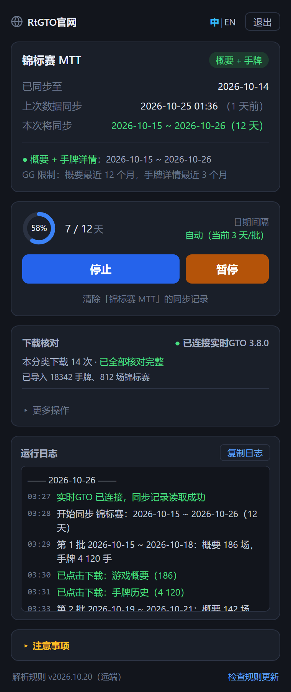

# GGPoker记录下载助手

**简体中文** | [English](README.en.md)

一个帮助 GGPoker 用户下载游戏记录和历史手牌的浏览器扩展，支持 Chrome 和 Microsoft Edge。
下载的记录可直接导入[实时GTO（RtGTO）](https://www.rtgto.net)分析。

软件官网：[www.rtgto.net](https://www.rtgto.net)

## 界面预览

<p>
  
</p>

同步中的主界面：同步状态、进度、[实时GTO](https://www.rtgto.net) 下载核对、运行日志。图中为示例数据。

## 功能特点

- **一键同步，不用选日期**：记住每个分类同步到了哪一天，点「开始同步」就把那之后到今天的记录补齐；第一次同步从 GG 还保留的最早一天开始。
- **支持 8 个分类**：锦标赛（MTT）、神秘大逃杀、黄金转盘下载游戏概要和手牌历史；极速现金局、德州扑克、奥马哈（PLO）、全押或弃牌、短牌下载手牌历史。
- **尽量下全**：GG 只保留最近 12 个月的概要、最近 3 个月的手牌，扩展按这个范围自动下载；批次跨度按 GG 单次上限（500 场概要 / 2 万手）自动调整，单日超限也会拆开下。
- **你来点下载**：每批都会高亮 GG 页面上的下载按钮，等你点击后再继续；可随时暂停、继续或停止。
- **还没打完的比赛**：照样下载已有的概要和手牌，比赛结束后再同步会从那天起重新下载完整数据。
- **配合[实时GTO](https://www.rtgto.net) 自动核对**：本机打开[实时GTO](https://www.rtgto.net) 时，下载的文件自动交给它检查并导入；网络中断等原因漏下的日期会列进「补下载」，一键补齐。
- **运行日志**：每一步都有记录，刷新或重新打开侧边栏后仍在，出问题时「复制日志」发给客服即可。
- **中英文界面**，支持 Chrome 和 Edge。
- **数据留在本地**：下载的记录保存在浏览器的下载目录，扩展不上传你的手牌。

## 系统要求

- Chrome 或 Microsoft Edge 116 或更高版本
- 仅支持 GGPoker 官方网站：
  - https://my.pokercraft.com/*
  - https://*.ggpoker.com/*
  - https://gateway.realtimegto.com/*

## 安装方法

1. 从 Chrome 网上应用店安装
   - 访问 Chrome 网上应用店
   - 搜索 "GGPoker记录下载助手"
   - 点击"添加到 Chrome"

2. 手动安装（开发版，Chrome）
   - 下载本项目的 ZIP 文件并解压
   - 打开 Chrome 浏览器，进入扩展程序页面 (chrome://extensions/)
   - 开启右上角的"开发者模式"
   - 点击"加载已解压的扩展程序"
   - 选择解压后的文件夹

3. 手动安装（开发版，Edge）
   - 下载本项目的 ZIP 文件并解压
   - 打开 Edge 浏览器，进入扩展页面 (edge://extensions/)
   - 打开左侧的"开发人员模式"
   - 点击"加载解压缩的扩展"
   - 选择解压后的文件夹
   - 在 GGPoker 网站上点工具栏的扩展图标（可在"扩展"菜单里把它固定到工具栏），侧边栏会在右侧打开

## 使用说明

1. 在 GGPoker 网站上点击扩展图标，打开 Side Panel
2. 首次使用需要登录：
   - 输入用户名和密码
   - 可选择"记住密码"
   - 点击"登录"按钮
3. 登录成功后设置下载参数：
   - 选择开始日期和结束日期（最长360天）
   - 选择日期间隔（1-3天）
4. 点击"开始"按钮开始下载
5. 下载过程中可以：
   - 点击"暂停"按钮暂停下载
   - 点击"停止"按钮终止下载
   - 查看实时下载进度和状态
6. 下载完成后：
   - 记录会保存在浏览器的下载目录中

## 下载记录与补下载（对接[实时GTO / RtGTO](https://www.rtgto.net) 分析模块）

扩展只能确认用户**点了**下载按钮，无法确认文件是否真正下载成功（网络中断时会静默失败）。
所以每段日期的处理结果都会记下来，交给[实时GTO](https://www.rtgto.net)分析模块核对，漏下的再导回来补下载。

1. 同步时自动记录（`download-ledger.js`，存在 `chrome.storage.local` 的 `ggDownloadLedger`）
2. 侧边栏「下载记录」→ 导出 JSON / CSV
3. [实时GTO](https://www.rtgto.net)分析模块核对，输出漏下的区间
4. 侧边栏「导入核对结果」→「补下载当前分类」：只下漏掉的日期和类别，不改同步进度

### 导出格式（`format: "gg-download-ledger"`）

- `categories[]`：按 `pageType × kind` 汇总，`covered` 已处理、`clicked` 点过下载、`noData` 确认无对局、`pending` 失败且未补上的日期段
- `entries[]`：逐条记录

| 字段 | 说明 |
| --- | --- |
| `pageType` | `tournament` / `rushAndCash` / `holdem` / `plo` / `battleRoyale`（神秘大逃杀）/ `spinAndGold`（黄金转盘）/ `aof`（全押或弃牌）/ `shortDeck`（短牌） |
| `kind` | `summary` 游戏概要（仅锦标赛）/ `history` 手牌历史 |
| `from` `to` | PokerCraft 日期筛选的起止日，含首尾，浏览器本地时区 |
| `status` | `clicked` 点了下载 / `no_data` 确认无对局 / `failed` 未完成 |
| `count` | 点下载时按钮上的条数 |
| `chunk` `rowRange` | 单日超限按行拆分时的第几趟、哪几行 |
| `availableFrom` | 当时 GG 还保留的最早日期（更早的本来就下不到） |
| `mode` | `sync` 正常同步 / `repair` 补下载 |
| `at` | 点击时间（带时区偏移） |

### 导入格式（`format: "gg-missing-ranges"`）

```json
{
  "format": "gg-missing-ranges",
  "formatVersion": 1,
  "missing": [
    { "pageType": "tournament", "kind": "history", "from": "2026-07-01", "to": "2026-07-03" },
    { "pageType": "plo", "from": "2026-08-10", "to": "2026-08-10" }
  ]
}
```

`kind` 省略表示两类都补（非锦标赛只有手牌）。超出 GG 保留期的部分无法补；晚于同步进度的部分交给正常同步。

### 和[实时GTO](https://www.rtgto.net) 自动核对（同一台机器）

[实时GTO](https://www.rtgto.net) 启动后在 `127.0.0.1` 上监听（端口 47651，被占用时顺延到 47652、47653），本机请求都接受，
不做来源校验——这只是本机上的便利通道。扩展侧的实现在 `rtgto-bridge.js`，[实时GTO](https://www.rtgto.net) 侧在
`pokermaster/lib/modules/as/service/gg_bridge/`。

1. 用户点 GG 的下载按钮时，content script 通知 background；background 用 `chrome.downloads`
   记下之后 15 分钟内开始的下载（`ggDownloads`：文件路径、完成 / 中断）。
2. 侧边栏按点击时间把下载对到每条 `clicked` 记录上（`GG_LEDGER.attachDownloads`）。
3. 每轮同步 / 补下载结束（或刚连上[实时GTO](https://www.rtgto.net) 时），侧边栏 `POST /gg-bridge/v1/verify`：

   ```json
   { "protocol": 1, "extensionVersion": "1.3.1", "downloadDir": "C:\\Users\\me\\Downloads",
     "entries": [ { "id": "…", "pageType": "tournament", "kind": "history", "from": "2026-07-01", "to": "2026-07-10",
                    "count": 95, "download": { "file": "C:\\…\\000001a0-….zip", "state": "complete" } } ] }
   ```

4. [实时GTO](https://www.rtgto.net) 逐个打开文件：下完没有、能否读取、类型对不对、文件数和按钮上的条数是否一致；
   导入并移动到备份目录后返回每条的 `status`（`ok` / `count_diff` / `downloading` / `interrupted` /
   `not_detected` / `file_missing` / `unreadable` / `wrong_kind`）和 `missing`（`gg-missing-ranges` 格式）。
5. 扩展把结果写回记录（`verify` 字段），没下到的日期自动进「补下载」清单。

开始同步时侧边栏会探测[实时GTO](https://www.rtgto.net) 是否打开，并提示去「GG数据导入」查看核对状态。

### 同步记录存在[实时GTO](https://www.rtgto.net) 里

每个分类（`tournament` / `rushAndCash` / `holdem` / `plo` / `battleRoyale` / `spinAndGold` / `aof` / `shortDeck`）同步到哪一天，保存在[实时GTO](https://www.rtgto.net) 的牌局数据库里
（`gg_sync_state` 表，[实时GTO](https://www.rtgto.net) 侧 `gg_sync_state_store.dart`），扩展自己不存（`sync-state.js` 经 background 转发）：

- [实时GTO](https://www.rtgto.net) 里没有这个分类的记录 = 没同步过，从 GG 保留期的最早一天开始；
- 在[实时GTO](https://www.rtgto.net) 里清空牌局时，同步记录一起清空，下次从头同步；切换数据库、备份恢复时同步记录跟着数据库走；
- 扩展里「清除同步记录」清的是[实时GTO](https://www.rtgto.net) 里这个分类的同步记录，已导入的数据不删；
- 连不上[实时GTO](https://www.rtgto.net)（或[实时GTO](https://www.rtgto.net) 太旧）时不能开始同步——不知道从哪天开始，不能当成没同步过从头重下。

```
GET  /gg-bridge/v1/sync-state  -> { "states": { "plo": { "lastSyncedDate": "2026-09-30", "lastDataSyncAt": 1790000000000, "batches": 12, "days": 90 } } }
POST /gg-bridge/v1/sync-state  { "op": "advance", "pageType": "plo", "date": "2026-10-01", "downloaded": true, "batches": 1, "days": 1 }
                               { "op": "rewind",  "pageType": "plo", "date": "2026-09-20" }
                               { "op": "clear",   "pageType": "plo" }
                               { "op": "migrate", "pageType": "plo", "date": "2026-09-10", "lastDataSyncAt": …, "batches": 7, "days": 30 }
                               -> { "state": { … } }（clear 之后为 null；migrate 另带 "migrated": true/false）
```

旧版扩展把同步记录存在本地（`ggSyncState`）。升级后第一次读写同步记录前，扩展把每个分类用 `migrate`
交给[实时GTO](https://www.rtgto.net)：[实时GTO](https://www.rtgto.net) 里已有这个分类的记录就以它为准，没有才接过来。全部交完才删本地这份；
迁移失败时读同步记录报错（不能开始同步），下次再试。

`advance` 只往前推、`rewind` 只往回退（[实时GTO](https://www.rtgto.net) 保证）。[实时GTO](https://www.rtgto.net) 的 `hello` 里 `protocol` ≥ 2 才有这组接口。

## 技术架构

- **前端界面**：
  - 使用原生 HTML/CSS/JavaScript
  - 采用 Side Panel API 实现现代界面
  - 响应式设计，适配不同屏幕尺寸
- **后台服务**：
  - 使用 Chrome Extension Manifest V3
  - Background Service Worker 处理核心逻辑
  - Content Script 实现页面交互
- **数据存储**：
  - Chrome Storage API 存储配置和状态
  - 本地文件系统保存下载记录
- **安全机制**：
  - 基于 Token 的身份验证
  - 本地加密存储敏感信息
  - 严格的域名白名单

## 注意事项

- 需要 Chrome 或 Edge 116 或更高版本才能使用侧边栏（Side Panel）功能
- 仅支持 GGPoker 官方网站，其他网站无法使用
- 建议每次下载的日期范围不要太大，以免影响性能
- 下载过程中请保持网络连接稳定
- 如遇到异常，可以：
  1. 刷新页面后重试
  2. 检查网络连接
  3. 确认登录状态
  4. 查看错误提示

## 隐私说明

- 本扩展仅在 GGPoker 官方网站上运行
- 不会收集或上传任何个人信息
- 所有数据仅保存在本地浏览器中
- 支持随时清除本地缓存数据

## 常见问题

1. 为什么扩展图标点击后没有反应？
   - 请确认您正在访问 GGPoker 官方网站
   - 检查 Chrome / Edge 浏览器版本是否满足要求（116+）
   - 确认扩展是否已正确安装

2. 下载过程中断怎么办？
   - 可以重新设置日期范围继续下载
   - 已下载的记录不会重复下载
   - 系统会自动跳过已处理的日期

3. 如何查看已下载的记录？
   - 下载的记录会保存在浏览器的下载目录中
   - 可以使用[RtGTO](https://www.rtgto.net)导入，形成分析结果

4. 登录失败怎么办？
   - 检查用户名和密码是否正确
   - 确认网络连接是否正常
   - 尝试清除浏览器缓存后重试
   - 联系客服获取支持

## 更新日志

### v1.0.0
- 初始版本发布
- 支持基本的记录下载功能
- 使用 Side Panel 界面
- 支持暂停/恢复下载
- 支持自定义日期范围
- 支持中英文双语界面
- 优化下载逻辑和错误处理
- 增强用户界面交互体验
- 添加详细的日志记录
- 改进按钮状态检测机制
- 优化网络请求处理

## 开发者信息

- 项目地址：[GitHub](https://github.com/gezhihua/gg-download)
- 问题反馈：请在 GitHub 上提交 Issue
- 贡献代码：欢迎提交 Pull Request

## 许可证

本项目采用 [PolyForm Noncommercial License 1.0.0](LICENSE)：个人、学习研究、非营利组织等非商业用途可以免费使用、修改和分发。

**商业用途需要单独授权**，请通过[实时GTO](https://www.rtgto.net) 官网联系。

## 打包说明

在工程目录下执行（会先做接口检查，输出 `../gg-download-<版本>.zip`）：
```shell
python build.py
```
不要用 `Compress-Archive`：它写出的 zip 路径分隔符是反斜杠，Chrome / Edge 加载会失败。

[实时GTO](https://www.rtgto.net) 内置了一份扩展（「GG数据导入」→「安装GG数据下载扩展」解压到[实时GTO](https://www.rtgto.net) 数据目录下的 `GGDownloadExtension` 文件夹）。
更新内置版本时加 `--copy-to`，把包复制成[实时GTO](https://www.rtgto.net) 仓库里的 `assets/gg_extension/gg-download-extension.zip`：
```shell
python build.py --copy-to <实时GTO 仓库>/assets/gg_extension
```
